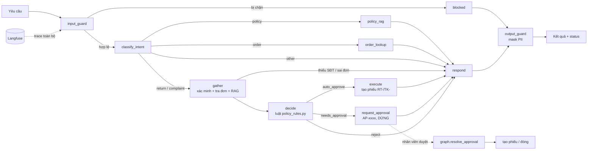

# Kiến trúc và hợp đồng giữa các module

## Bài toán

Khách gửi **một yêu cầu** (hỏi chính sách, hỏi đơn, đổi trả, khiếu nại). Với đổi trả và khiếu nại, agent tự tra đơn,
đối chiếu chính sách, **quyết định và thực hiện hành động** (tạo phiếu). Ca rủi ro thì **dừng chờ nhân viên duyệt**.
Kết quả là một yêu cầu được xử lý xong (`status`), không chỉ là một câu trả lời.

| intent | Loại | Kết quả (`status`) |
|---|---|---|
| `policy`, `order`, `other` | chỉ hỏi thông tin | `answered` |
| `return` (đổi trả) | yêu cầu, cần xác minh đơn | `completed` / `pending_approval` / `rejected` / `need_info` |
| `complaint` (khiếu nại) | yêu cầu | `completed` / `pending_approval` |

## Luồng xử lý

### Luật quyết định (`app/policy_rules.py`, viết bằng code, không để LLM quyết)

| Tình huống | Quyết định |
|---|---|
| Đơn đã có phiếu đổi trả đang mở | reject (chống tạo trùng) |
| Đơn đã hủy / chưa giao | reject |
| Quá `RETURN_WINDOW_DAYS` (7) ngày, không báo lỗi | reject |
| Hàng đã giặt / đã sử dụng, không báo lỗi | reject |
| Quá hạn hoặc đã giặt **nhưng báo lỗi sản phẩm** (ngoại lệ) | needs_approval |
| Đơn giá trị ≥ `APPROVAL_THRESHOLD_VND` (1.000.000đ) | needs_approval |
| Khiếu nại có bồi thường / đe dọa pháp lý, truyền thông | needs_approval |
| Còn lại | auto_approve |

Các con số (7 ngày, 1 triệu) nằm trong `app/config.py` và **phải khớp file chính sách của B**.

## Hợp đồng (KHÔNG đổi chữ ký nếu chưa báo cả nhóm)

| Module | Owner | Chữ ký | Ghi chú |
|---|---|---|---|
| `app/rag.py` | B | `retrieve(query: str, k: int = 4) -> list[Chunk]` | `Chunk = {text, source}` |
| `app/tools.py` | C | `get_order(order_id: str, phone_last4: str \| None) -> dict \| None` | Trả `None` cả khi không có đơn lẫn sai SĐT, không trả `phone_last4` ra ngoài |
| `app/tools.py` | C | `create_complaint(order_id, content) -> str` | Trả `ticket_id` (TK-xxxx) |
| `app/tools.py` | C | `create_return(order_id, content) -> str` | Trả `ticket_id` (RT-xxxx) |
| `app/tools.py` | C | `find_open_request(order_id, kind) -> str \| None` | Phiếu / yêu cầu chờ duyệt đang mở, chống tạo trùng |
| `app/tools.py` | C | `submit_for_approval(kind, order_id, content, reasons) -> str` | Trả `approval_id` (AP-xxxx) |
| `app/tools.py` | C | `list_pending_approvals() -> list[dict]`, `resolve_approval(id, approve, reviewer, note) -> dict` | Hàng chờ nhân viên; duyệt thì tự tạo phiếu, không duyệt hai lần |
| `app/guardrails.py` | D | `input_guard(text) -> GuardResult(blocked, reason)` | Chạy trước mọi thứ khác |
| `app/guardrails.py` | D | `output_guard(text) -> (text, pii_found)` | Chạy cuối cùng, kể cả nhánh bị chặn |
| `app/observability.py` | D | `get_run_config(session_id, tags) -> dict` | `{}` khi chưa cấu hình Langfuse |
| `app/llm.py` | A | `classify_intent(q) -> IntentResult`, `generate_answer(...) -> str` | `LLM_PROVIDER=stub` chạy offline |
| `app/graph.py` | A | `run(question, session_id=None) -> AgentState` | Điểm vào cho khách: CLI, UI, evals |
| `app/graph.py` | A | `resolve_approval(approval_id, approve, reviewer, note="") -> dict` | Điểm vào cho nhân viên duyệt; trả thông báo gửi khách |
| `app/policy_rules.py` | A + B | `decide_return(...)`, `decide_complaint(...) -> Decision` | Luật quyết định, B xác nhận số liệu khớp chính sách |

`AgentState` (xem `app/state.py`) là nơi mọi node đọc/ghi dữ liệu. Muốn thêm trường, tạo PR riêng sửa `state.py`.

## Quy tắc thiết kế đã chốt

1. **Stub trước, thật sau.** Mọi module đã có bản stub chạy offline. Thay phần thân, giữ chữ ký, giữ test xanh.
2. **Không bịa.** Nhánh policy không có context thì trả `MSG_NO_INFO`, không cho model tự trả lời.
3. **Xác minh trước khi tra đơn** (mã đơn + 4 số cuối SĐT), bật/tắt bằng `REQUIRE_PHONE_VERIFY`.
4. **Output guard luôn chạy cuối**, kể cả khi bị chặn ở input.
5. **Một điểm vào cho khách** `graph.run()`: CLI, UI và evals đều gọi qua đây nên trace và hành vi nhất quán.
6. **Quyết định bằng luật, hành động bằng code.** LLM chỉ phân loại và viết câu trả lời thông tin; kết quả hành động (mã phiếu, lý do từ chối) dùng câu cố định để không bịa mã phiếu hay hứa sai.
7. **Hành động thay đổi dữ liệu cần xác minh** (mã đơn + 4 số cuối SĐT). Khiếu nại thông thường không cần vì rủi ro thấp.
9. **Hỏi lại khi thiếu thông tin, nhớ theo phiên.** `graph.run(question, session_id)`: nếu agent hỏi lại (`status=need_info`) thì nhớ yêu cầu đang dở của phiên đó; lượt sau khách chỉ gõ "SĐT cuối 1111" hay "1111" là tiếp tục đúng yêu cầu, giữ nguyên lý do ở lượt đầu. Xong việc hoặc khách đổi chủ đề thì quên. UI phải truyền cùng `session_id` cho cả cuộc chat.
10. **Không đủ chính sách thì chuyển nhân viên.** Nhánh policy không có đoạn nào đủ liên quan (`score` < `RAG_MIN_SCORE`, nếu B trả `score`) thì trả `MSG_NO_INFO` và đặt `handoff=True`, không để model tự trả lời.
11. **`LLM_STRICT=true` khi chạy eval**: gọi Gemini lỗi thì báo lỗi, không rơi về luật từ khóa làm sai lệch số liệu.
8. **Rủi ro thì dừng, không tự làm.** Ca `needs_approval` không tạo phiếu cho đến khi nhân viên gọi `resolve_approval`.
