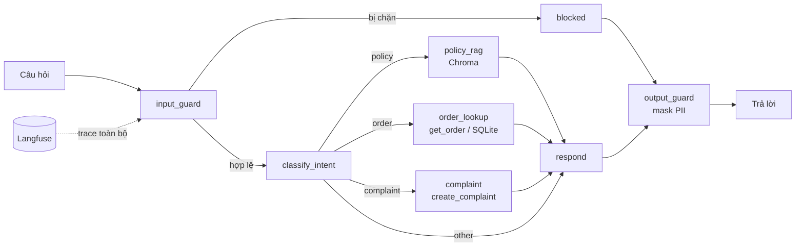

# Kiến trúc và hợp đồng giữa các module

## Luồng xử lý

## Hợp đồng (KHÔNG đổi chữ ký nếu chưa báo cả nhóm)

| Module | Owner | Chữ ký | Ghi chú |
|---|---|---|---|
| `app/rag.py` | B | `retrieve(query: str, k: int = 4) -> list[Chunk]` | `Chunk = {text, source}` |
| `app/tools.py` | C | `get_order(order_id: str, phone_last4: str \| None) -> dict \| None` | Trả `None` cả khi không có đơn lẫn sai SĐT, không trả `phone_last4` ra ngoài |
| `app/tools.py` | C | `create_complaint(order_id, content) -> str` | Trả `ticket_id` |
| `app/guardrails.py` | D | `input_guard(text) -> GuardResult(blocked, reason)` | Chạy trước mọi thứ khác |
| `app/guardrails.py` | D | `output_guard(text) -> (text, pii_found)` | Chạy cuối cùng, kể cả nhánh bị chặn |
| `app/observability.py` | D | `get_run_config(session_id, tags) -> dict` | `{}` khi chưa cấu hình Langfuse |
| `app/llm.py` | A | `classify_intent(q) -> IntentResult`, `generate_answer(...) -> str` | `LLM_PROVIDER=stub` chạy offline |
| `app/graph.py` | A | `run(question, session_id=None) -> AgentState` | Điểm vào duy nhất cho CLI, UI, evals |

`AgentState` (xem `app/state.py`) là nơi mọi node đọc/ghi dữ liệu. Muốn thêm trường, tạo PR riêng sửa `state.py`.

## Quy tắc thiết kế đã chốt

1. **Stub trước, thật sau.** Mọi module đã có bản stub chạy offline. Thay phần thân, giữ chữ ký, giữ test xanh.
2. **Không bịa.** Nhánh policy không có context thì trả `MSG_NO_INFO`, không cho model tự trả lời.
3. **Xác minh trước khi tra đơn** (mã đơn + 4 số cuối SĐT), bật/tắt bằng `REQUIRE_PHONE_VERIFY`.
4. **Output guard luôn chạy cuối**, kể cả khi bị chặn ở input.
5. **Một điểm vào** `graph.run()`: CLI, UI và evals đều gọi qua đây nên trace và hành vi nhất quán.
